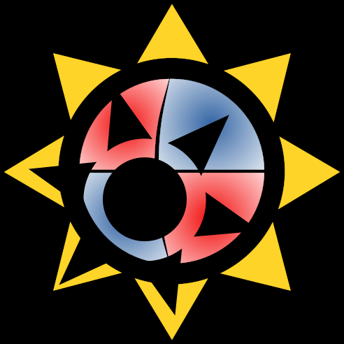

# STAR SHADOW
### Satellite Time-series Analysis Routine using Sinusoids and Harmonics Automatedly for Double stars with Occultations and Waves


<a href="./LICENCE.md"></a>

[//]: # (<a href="https://github.com/LucIJspeert/star_shadow/blob/master/LICENCE.md"></a>)

[//]: # (make the badges dynamic...)

## Table of contents

1. [What is STAR SHADOW?](#WhatisSTARSHADOW?)
2. [Reference material](#ReferenceMaterial)
3. [Getting started](#GettingStarted)
    1. [Installation](#Installation)
    2. [Example use](#ExampleUse)
    3. [Explanation of output](#Explanationofoutput)
    4. [Diagnostic plots](#Diagnosticplots)
    5. [Alternate pre-whitening settings](#Alternateprewhiteningsettings)
4. [Bugs and Issues](#BugsandIssues)
5. [Contact](#Contact)


## What is STAR SHADOW? <a name="WhatisSTARSHADOW"></a>
STAR SHADOW is a Python code that is aimed at the automatic analysis of space based light curves of eclipsing binaries
and provide a measurement of eccentricity, among other parameters. It provides a recipe to measure timings of eclipses
using the time derivatives of the light curves, using a model of orbital harmonics obtained from an initial iterative
prewhitening of sinusoids. Since the algorithm extracts the harmonics from the rest of the sinusoidal variability
eclipse timings can be measured even in the presence of other (astrophysical) signals. The aim is to determine
the orbital eccentricity automatically from the light curve along with information about the other variability present
in the light curve. The output includes, but is not limited to, a sinusoid plus linear model of
the light curve, the orbital period, the eccentricity, argument of periastron and inclination. See the documentation
for more information.




### Reference material <a name="ReferenceMaterial"></a>

* This algorithm has been documented, tested and applied in the publication: [Automated eccentricity measurement from raw eclipsing binary light curves with intrinsic variability](https://ui.adsabs.harvard.edu/abs/2024arXiv240206084I/abstract)

## Getting started <a name="GettingStarted"></a>


### Installation <a name="Installation"></a>

The easiest way to install STAR SHADOW is to use pip:

```bash
    pip install git+https://github.com/LucIJspeert/star_shadow@<version_tag>
```

Or install the master branch by leaving out the version number.
Before doing so, it is recommended to install the packages specified in the requirements with Conda.
Your favorite package manager may be used of course, but pip kind of sucks and may fail installation in a clean environment.

One can then import the package from the python environment it was installed in.
Of course one can always still manually download it or make a fork on GitHub.
It is recommended to get the latest release from the GitHub page.

**STAR SHADOW has only been tested in Python 3.7**. Using older versions could result in unexpected errors,
although any Python version >=3.6 is expected to work.

**Package dependencies:** The following package versions have been used in the development of this code,
meaning older versions can in principle work, but this is not guaranteed.
- NumPy 1.20.3
- SciPy 1.7.3
- Numba 0.55.1
- h5py 3.7.0
- Astropy 4.3.1
- Matplotlib 3.5.3
- Arviz 0.11.4
- corner 2.2.1
- pymc3 3.11.4 (optional)
- theano 1.1.2 (optional)
- fastprogress 1.0.0 (optional)
- ellc 1.8.5 (optional)

Newer versions are expected to work, and it is considered a bug if this is not the case.

Before first use, it is recommended to run one very short time-series (for example sim_000_lc.dat included in the data
folder). This will make sure that the just-in-time compiler can do its magic and make everything run as fast as it can. See the
script run_first_use.py.

Note: there is a known incompatibility with Windows and the `np.int_` types used for Numba. Changing these to `np.int64` should resolve this issue on Windows.

### Example use <a name="ExampleUse"></a>

Since the main feature of STAR SHADOW is its fully automated operation, taking advantage of its functionality is
as simple as running one function:

```python
    import star_shadow as sts
    # to analyse any light curve from a file:
    sts.analyse_lc_from_file(file, p_orb=0, i_sectors=None, stage='all', method='fitter', data_id='none', save_dir=None, overwrite=False, verbose=True)

    # or to analyse from a set of TESS data product .fits files:
    sts.analyse_lc_from_tic(tic, all_files, p_orb=0, i_sectors=None, stage='all', method='fitter', data_id=None, save_dir=None, overwrite=False, verbose=True)
```

The light curve file is expected to contain a time column, flux measurements (median normalised and non-negative),
and flux measurement errors. The normalisation for TESS data products is handled automatically on a per-sector basis.
The `stage` parameter can be set to indicate which parts of the analysis are performed, see the documentation for options.

If a `save_dir` is given, the outputs are saved in that directory with either the TIC number or the file name as
identifier. If not given, files are saved in a subdirectory of where the light curve file is.
The `overwrite` argument can be used to overwrite old data or to continue from a previous save file. The functions can
print useful progress information if `verbose=True`. If an orbital period is known beforehand, this information
will be used to find orbital harmonics in the prewhitened frequencies. If left zero, a period is found through
a combination of phase dispersion minimisation, Lomb-Scargle periodogram and extracted frequencies. For the
`analyse_from_tic` function, the files corresponding to the given TIC number are picked out from a list of all
available TESS data files, provided by the user, for ease of use.

Either function can be used for a set of light curves by using:
```python
    sts.analyse_set(target_list, function='analyse_from_tic', n_threads=os.cpu_count() - 2, **kwargs):
```


### Explanation of output <a name="Explanationofoutput"></a>

Results are saved mainly in hdf5 files, in addition to csv and sometimes nc4 files. A plain text log file keeps track
of the start and end time of the analysis and can contain important messages about the operation of the algorithm,
like a reason for early termination.

Currently, there are a total of 9 analysis steps. Normal operation can terminate at several intermediate stages.
A log entry is made when this happens containing further information. The analysis can stop if for example no
frequencies were extracted, the period is too long for the given data set, not enough orbital harmonics are found,
or primary or secondary eclipse cannot be identified.

Each step produces at least an .hdf5 file with all the model parameters from that stage of the analysis.
The utility module contains a function for reading these files, `read_parameters_hdf5`, which outputs a convenient
format for the data (note that reading in these files with H5py directly will not result in formatting that can be used
with the functions of STAR SHADOW). The .hdf5 files can also be translated into several plain text .csv files with
`convert_hdf5_to_ascii`. The .nc4 files (a wrapper for hdf5) contain pymc3 sampling chains.


### Diagnostic plots <a name="Diagnosticplots"></a>


There are several plotting functions available that show various diagnostics from throughout the analysis. The function:

```python
    sts.ut.sequential_plotting(times, signal, i_sectors, target_id, load_dir, save_dir=None, show=False)
```

saves and/or shows most of the available plots for one target. Unfortunately matplotlib plotting only works in
the main thread, so when processing a whole set of light curves in parallel, this function will have to be run
sequentially on the results afterwards (hence the name).

### Alternate pre-whitening settings <a name="Alternateprewhiteningsettings"></a>

Thanks to its rapid frequency analysis, STAR SHADOW is also used to perform pre-whitening in asteroseismic studies
(e.g. [Jannsen et al. (2025)](https://ui.adsabs.harvard.edu/abs/2025A%26A...694A.185J/abstract),
[Fritzewski et al. (2025)](https://ui.adsabs.harvard.edu/abs/2025A%26A...698A.253F/abstract),
[Vandersnickt et al. (2025)](https://ui.adsabs.harvard.edu/abs/2025A%26A...704L..13V/abstract)).
However, STAR SHADOW usually extracts many more frequencies than desirable for asteroseismic purposes. Therefore, STAR SHADOW features a number of optional settings one can use to optimise the pre-whitening procedure to avoid overextraction. These settings and their default values are
- `bic_thr = 2` : Threshold for reduction in BIC for a signal to be accepted as significant.
- `sn_thr = -1` :  Threshold for signal-to-noise ratio for a signal to be accepted as signficant. If `sn_thr == -1`, the threshold is automatically computed using the formula of [Baran et al. (2021)](https://ui.adsabs.harvard.edu/abs/2021AcA....71..113B/abstract).
- `sn_thr_punish_gap = False` : Whether to increase the SNR threshold by 0.25 if there is at least one sector-long gap as suggested by [Baran et al. (2021)](https://ui.adsabs.harvard.edu/abs/2021AcA....71..113B/abstract). Only relevant if sn_thr == -1. This assumes the time column in the light curve is measured in days.
- `f_max = 0` : Maximum allowed frequency at which signals are extracted. If `f_max == 0`, it automatically uses the Nyquist frequency as the upper limit.
- `add_SNR_stop_crit = False` : If True, the signal-to-noise ratio is used as a second stopping criterion on top of the demanded decrease in BIC.
- `fit_each_step = False` : If True, a non-linear least-squares fit of all extracted sinusoids in groups is performed after each extracted frequency. While this increases the quality of the extracted signals, it drastically slows down the code!

Changing these settings can have a detrimental effect on the analysis of eclipses, which generally benefits from as many sinusoids being extracted from the light curve as possible. Consequently, these features should only be used when one only uses STAR SHADOW for its pre-whitening procedures. By default, STAR SHADOW will refuse to perform a binary analysis when these settings are changed from their defaults, so one can only use non-default values if `stage` equals `frequencies`, `freq`, or `f`. An experienced user can force STAR SHADOW to use the non-default settings on an ecplising binary analysis by settting `enforce_settings = True`.


## Bugs and Issues <a name="BugsandIssues"></a>

Despite all the testing, I am certain that there are still bugs in this code, or will be created in future versions.

If you happen to come across any bugs or issues, *please* contact me. Only known bugs can be resolved.
This can be done through opening an issue on the STAR SHADOW GitHub page:
[LucIJspeert/star_shadow/issues](https://github.com/LucIJspeert/star_shadow/issues),
or by contacting me directly (see below).

If you are (going to be) working on new or improved features, I would love to hear from you and see if it can be
implemented in the source code.


## Contact <a name="Contact"></a>

For questions and suggestions, please open an issue.

**Developer:** Luc IJspeert (developed while at KU Leuven)
